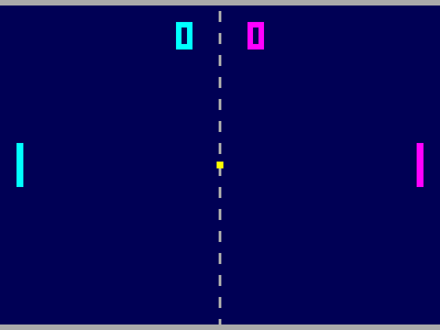

# Pong with a trail

A small digital chip, written in Verilog, that plays two-player Pong on a VGA
monitor. The ball leaves a tapering trail of copies of itself in the same
colour, and every return makes it a little faster. The paddles speed up along
with it, so rallies get more intense without becoming impossible. First to 9
wins.



*Simulated output, decoded from the chip's pins. Two robot players drive the
chip's buttons; the right one is deliberately slow so it misses now and then.*

## Try it in your browser

1. Open [vga-playground.com](https://vga-playground.com).
2. Open the `project.v` tab, select all and paste in
   [`playground/project.v`](playground/project.v) (use the *Raw* button on
   GitHub to copy it). Leave the playground's `hvsync_generator.v` tab alone.
3. Click the **gamepad** button (*Toggle Gamepad Mode*) next to `ui_in`
   above the picture to turn on the emulated Gamepad Pmod. Then click
   somewhere outside the code editor, so it doesn't catch the key presses,
   and play:

| Player | Up | Down |
|--------|----|------|
| Left (cyan)     | **S** | **X** |
| Right (magenta) | **↑** | **↓** |

**T** starts a new game.

The playground only passes the arrow keys and A, B, X, Y, L, R, S and T to
the chip (as an emulated SNES-style controller), so **W** can't be used;
S and X sit right above each other, which is the closest match to W/S.

In my tests in the playground's own simulator it ran at about 32 fps, with
exactly the same pixels as the real chip. The game counts in frames, so below
60 fps it plays a little slower than on real hardware.

`playground/project.v` is the design file with a header of playground
instructions, generated by `make playground`.

The whole design is a single module, `tt_um_pvpgrief_pong`, with no
submodules. That way tools that check "the" module for the Tiny Tapeout
ports (such as Vulkos) can't pick the wrong one, and it doesn't clash with
the `hvsync_generator.v` the playground adds to every project.

## Pins

The design uses the [Tiny Tapeout](https://tinytapeout.com) interface
(`tt_um_pvpgrief_pong`), with video on the
[TinyVGA Pmod](https://github.com/mole99/tiny-vga) pinout.

| Pin | Function |
|-----|----------|
| `clk`   | 25.175 MHz pixel clock (25 MHz works on most monitors) |
| `rst_n` | Active-low synchronous reset |
| `ui[0]` / `ui[1]` | Left paddle up / down (1 = pressed) |
| `ui[2]` / `ui[3]` | Right paddle up / down |
| `ui[4..6]` | [Gamepad Pmod](https://github.com/psychogenic/gamepad-pmod) latch, clock, data |
| `ui[7]` | New game |
| `uo[7:0]` | `{HSync, B0, G0, R0, VSync, B1, G1, R1}`: 640×480 @ 60 Hz, 2 bits per colour |

With the Gamepad Pmod and two controllers, controller 1's D-pad moves the
right paddle and controller 2's D-pad moves the left paddle. Controller 1's
Select/X also move the left paddle (that's what S/X do in the playground),
and Start on either controller starts a new game.

## How it works

```
                     ┌─────────────┐  hpos/vpos
                     │ VGA timing  ├──────────────┐
                     │ 640x480@60  │              │
                     └──────┬──────┘              ▼
  ui[0..3] ──┐              │ frame tick   ┌──────────────┐  rgb  ┌──────┐
             ├─► controls ─►┌──────────┐──►│   picture    ├──────►│ regs ├──► uo_out
  ui[4..6] ──┤  (gamepad)   │   game   │   └──────────────┘       └──────┘
  ui[7] ─────┘              └──────────┘  paddles, ball, trail, scores
```

Everything is in [`src/tt_um_pvpgrief_pong.v`](src/tt_um_pvpgrief_pong.v),
in four sections:

| Section | What it does |
|---------|--------------|
| VGA timing | Counters and sync pulses for 640×480 @ 60 Hz |
| Controls | Reads the Gamepad Pmod's serial stream (two controllers), maps buttons to paddles, LFSR for serves |
| Game | Once per frame: paddles, ball physics, bounces, scoring, serve/game-over states, trail history |
| Picture | Walls, centre line, paddles, score digits, ball and trail |

- **Speed.** Speeds are kept in 1/16 px per frame. The ball starts at
  4 px/frame across and gains 1/4 px/frame on every return, up to
  10 px/frame (after 24 returns). The paddles always move 3 px/frame faster
  than that: 7 px/frame at the start, up to 13. Both reset after each point.
- **Bounces.** Where the ball meets the paddle sets its vertical speed
  (1 to 6 px/frame): hit it with the paddle's edge for a steep return.
- **Trail.** The game remembers the ball's last five positions (every other
  frame) and draws them behind it as copies 8, 8, 6, 6 and 4 px wide.
- **Serve and game over.** After a point the ball blinks in the middle for a
  second, then goes toward the player who lost the point, at a random
  angle. At 9 points the winner's score blinks for 4 s and a new game starts.
- **Drawing.** Everything that only depends on the line (which objects cross
  it, which row of the digits it shows) is worked out once per line during
  horizontal blanking, so each pixel needs only a few comparisons. The per-
  frame game logic is likewise prepared on the two lines before the update.
  This keeps the design small and fast to simulate.

## Running it

You need [Verilator](https://verilator.org), [Icarus Verilog](https://steveicarus.github.io/iverilog/),
[Yosys](https://yosyshq.net/yosys/) and Python 3 with Pillow (the last only for the GIF).

```sh
make lint        # verilator -Wall lint (clean)
make test        # Icarus testbench: 2 frames, sync timing, known pixels (~10 s)
make sim         # Verilator virtual monitor with robot players (~1.5 min)
make gif         # re-render docs/preview.gif
make synth       # Yosys generic synthesis + cell count
make playground  # regenerate playground/project.v
```

`make sim` drives the chip through its pins only. The simulator
([`sim/sim_main.cpp`](sim/sim_main.cpp)) recovers the picture from the sync
pulses the way a monitor would, finds the ball, paddles and scores in it, and
presses the chip's buttons. It checks:

- every hsync/vsync period and pulse width, and that nothing is driven
  during blanking;
- the plain buttons, and the Gamepad Pmod path (arrows, S and X, emulated
  exactly as the playground sends them);
- that two robot players can keep a rally going (paddle bounces, no misses,
  a visible trail);
- that the ball and the paddles get faster during the rally;
- that a player who stops defending loses points.

## Size

Generic Yosys synthesis gives about 4.2k gates and 355 flip-flops. The
`tiles: "3x2"` in `info.yaml` is an estimate that has not been through the
Tiny Tapeout hardening flow yet. The design also fits easily on any small
FPGA with a VGA output.
